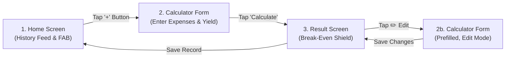

# User Guide & UX Design Principles 📱

The **Kasekor Calculator (កសិករគណនា)** is designed specifically for rural farmers in Cambodia. The user interface prioritizes clarity, ease of use under direct sunlight, and immediate financial feedback.

---

## 🗺️ User Journey & Screen Walkthrough

### Screen 1: Home Screen (ទំព័រដើម)
- **Purpose:** View historical cultivation records and start a new calculation.
- **Key Components:**
  - **Top Bar:** App title in Khmer (`កសិករគណនា`).
  - **History Feed:** Scrollable list of past crop cycles showing total cost, yield, and break-even price.
  - **Empty State:** Friendly graphic & message when no saved records exist (`មិនទាន់មានទិន្នន័យ`).
  - **Floating Action Button (FAB):** Large green button (`+`) at the bottom right.

---

### Screen 2: Calculator Form Screen (ទម្រង់គណនា)
- **Purpose:** Input seasonal expenses and expected harvest weight.
- **Input Fields:**
  1. 🌾 **Crop Type:** Dropdown selector (Rice / ស្រូវ, Cassava / ដំឡូង, Mango / ស្វាយ).
  2. 💵 **Currency (រូបិយប័ណ្ណ):** រៀល (KHR, default) or ដុល្លារ (USD). Expense labels and totals follow the choice.
  3. 🌱 **Seeds Expense (ថ្លៃពូជ):** Numeric input in the chosen currency.
  4. 💧 **Fertilizer & Pesticide Expense (ថ្លៃជី និងថ្នាំ):** Numeric input.
  5. 🚜 **Fuel & Equipment Expense (ថ្លៃប្រេង និងឧបករណ៍):** Numeric input.
  6. 👨‍🌾 **Labor Expense (ថ្លៃពលកម្ម):** Numeric input.
  7. ⚖️ **Yield Unit & Expected Yield (ទិន្នផលរំពឹងទុក):** Choose គីឡូក្រាម (kg, default) or តោន (ton), then enter the weight.
- **Real-Time Total:** Bottom bar live-updates total expenses as values are entered.
- **Edit Mode (កែប្រែវដ្តដំណាំ):** Opened from the ✏️ button on the Result screen. Every field is prefilled; **រក្សាទុកការកែប្រែ** saves over the same record (its date and place in the history list are kept) and returns to the Result screen. Pressing Back with unsaved changes asks whether to discard them. Changing the currency clears the saved buyer offer; amounts are never converted.

---

### Screen 3: Result Screen (លទ្ធផល និងការចរចា)
- **Purpose:** Display break-even price and simulate buyer offers.
- **Key Display Elements:**
  - 🛡️ **Break-Even Price Highlight:** Displays minimum sell price in the cycle's currency and unit (e.g., `1,200 រៀល / គីឡូក្រាម` or `$300.00 / តោន`).
  - 💵 **Negotiation Simulator:** Input middleman offer price (same currency and unit) to test profit/loss. The price is saved when you press Enter or the save button.
  - 🎨 **Visual Indicator:**
    - 🟢 **Green Card & Text:** Offer > Break-Even (Profitable trade).
    - 🔴 **Red Card & Warning Alert:** Offer < Break-Even (Loss warning).

---

## 🎨 Rural UX & Accessibility Standards

| Design Element | Standard | Rationale |
| :--- | :--- | :--- |
| **Typography** | Google **Kantumruy Pro** (`>= 16.sp` body, `>= 22.sp` header) | Clear legibility for Khmer script across age groups |
| **Touch Targets** | Minimum **`56.dp`** height for all buttons & inputs | Easy touch interaction for calloused hands in field environments |
| **Keyboards** | Automatic `KeyboardType.Decimal` on amount fields (allows cents for USD) | Saves user from manually toggling complex keyboard layouts |
| **Color Contrast** | High contrast (#2E7D32 Green, #F9F9F9 Off-white background) | Ensures display remains visible under direct sun sunlight |
| **Iconography** | Universal icons alongside every Khmer label | Assists users with varying literacy levels |
