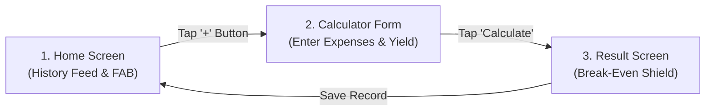

# User Guide & UX Design Principles 📱

The **Kasekor Calculator (កសិករគណនា)** is designed specifically for rural farmers in Cambodia. The user interface prioritizes clarity, ease of use under direct sunlight, and immediate financial feedback.

---

## 🗺️ User Journey & Screen Walkthrough

### Screen 1: Home Screen (ទំព័រដើម)
- **Purpose:** View historical cultivation records and start a new calculation.
- **Key Components:**
  - **Top Bar:** App title in Khmer (`កសិករគណនា`).
  - **History Feed:** Scrollable list of past crop cycles showing total cost, yield, and break-even price.
  - **Empty State:** Friendly graphic & message when no saved records exist (`មិនទាន់មានទិន្នន័យ`).
  - **Floating Action Button (FAB):** Large green button (`+`) at the bottom right.

---

### Screen 2: Calculator Form Screen (ទម្រង់គណនា)
- **Purpose:** Input seasonal expenses and expected harvest weight.
- **Input Fields:**
  1. 🌾 **Crop Type:** Dropdown selector (Rice / ស្រូវ, Cassava / ដំឡូង, Mango / ស្វាយ).
  2. 🌱 **Seeds Expense (ថ្លៃពូជ):** Numeric input in KHR or USD.
  3. 💧 **Fertilizer & Pesticide Expense (ថ្លៃជី និងថ្នាំ):** Numeric input.
  4. 🚜 **Fuel & Equipment Expense (ថ្លៃប្រេង និងឧបករណ៍):** Numeric input.
  5. 👨‍🌾 **Labor Expense (ថ្លៃពលកម្ម):** Numeric input.
  6. ⚖️ **Expected Yield (ទិន្នផលរំពឹងទុក):** Input weight in Kilograms (kg) or Tons.
- **Real-Time Total:** Bottom bar live-updates total expenses as values are entered.

---

### Screen 3: Result Screen (លទ្ធផល និងការចរចា)
- **Purpose:** Display break-even price and simulate buyer offers.
- **Key Display Elements:**
  - 🛡️ **Break-Even Price Highlight:** Displays minimum sell price per kg (e.g., `1,200 ៛/kg`).
  - 💵 **Negotiation Simulator:** Input middleman offer price to test profit/loss.
  - 🎨 **Visual Indicator:**
    - 🟢 **Green Card & Text:** Offer > Break-Even (Profitable trade).
    - 🔴 **Red Card & Warning Alert:** Offer < Break-Even (Loss warning).

---

## 🎨 Rural UX & Accessibility Standards

| Design Element | Standard | Rationale |
| :--- | :--- | :--- |
| **Typography** | Google **Kantumruy Pro** (`>= 16.sp` body, `>= 22.sp` header) | Clear legibility for Khmer script across age groups |
| **Touch Targets** | Minimum **`56.dp`** height for all buttons & inputs | Easy touch interaction for calloused hands in field environments |
| **Keyboards** | Automatic `KeyboardType.Number` on field focus | Saves user from manually toggling complex keyboard layouts |
| **Color Contrast** | High contrast (#2E7D32 Green, #F9F9F9 Off-white background) | Ensures display remains visible under direct sun sunlight |
| **Iconography** | Universal icons alongside every Khmer label | Assists users with varying literacy levels |
